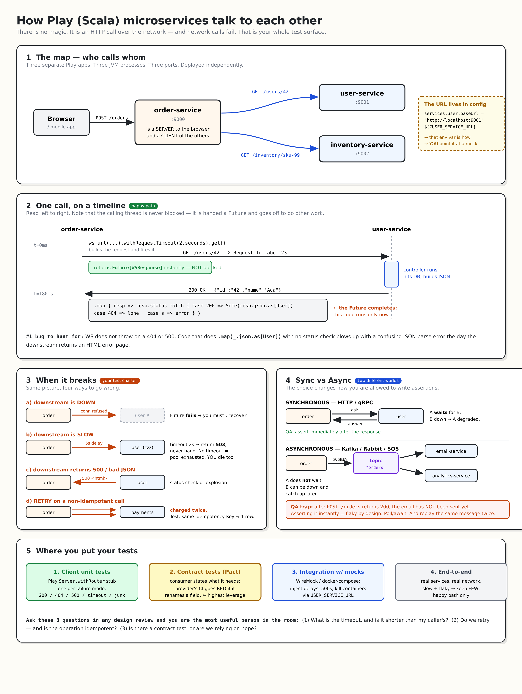

# Play (Scala) microservices skeleton

Companion material:

- [`docs/play-microservices-guide.md`](docs/play-microservices-guide.md) — the step-by-step guide the `// TODO` markers refer to.
- [`docs/play-microservices-sketch.png`](docs/play-microservices-sketch.png) — the same thing as one visual page.



Two independent Play applications. Every file already exists with the right
package, class name and imports; the bodies are `// TODO` markers that point
at the section of `play-microservices-guide.md` to paste in.

```
user-service/     :9001   the CALLEE  (a plain HTTP API)
order-service/    :9000   the CALLER  (uses Play WS to call user-service)
```

## Open in Windsurf

Open each service as its own project/window (they are separate sbt builds):

```
File > Open Folder... > user-service
File > Open Folder... > order-service
```

Install the **Scala (Metals)** extension and let it import the build the first
time you open a `.scala` file. First import downloads the Play/Scala artifacts
and takes a few minutes.

## A note on `conf/routes`

Play **compiles** the routes file, so a route pointing at a method that does not
exist yet is a build error. Every route therefore starts commented out —
uncomment each one as you implement its controller method. The skeleton compiles
green before you have written a single line.

## Run

```bash
cd user-service  && sbt run     # -> http://localhost:9001
cd order-service && sbt run     # -> http://localhost:9000
```

## Verify

```bash
curl -i http://localhost:9001/users/42
curl -i "http://localhost:9000/orders?userId=42"
```

## Test

```bash
sbt test
```

## Fill-in order (follow the guide)

| # | File | Guide section |
|---|------|---------------|
| 1 | `user-service/app/models/User.scala` | Part 2, Step 1 |
| 2 | `user-service/app/controllers/UserController.scala` | Part 2, Step 1 |
| 3 | `order-service/conf/application.conf` | Part 2, Step 3 |
| 4 | `order-service/app/models/User.scala` | Part 2, Step 1 |
| 5 | `order-service/app/clients/UserClient.scala` | Part 2, Step 4 |
| 6 | `order-service/app/controllers/OrderController.scala` | Part 2, Step 5 |
| 7 | `order-service/test/clients/UserClientSpec.scala` | Part 5, Level 1 |
| 8 | `order-service/app/clients/ResilientUserClient.scala` | Part 3, circuit breaker |
| 9 | `order-service/app/filters/CorrelationIdFilter.scala` | Part 3, correlation IDs |

## The two experiments that actually teach you this

1. Kill `user-service` and curl `order-service`. Keep fixing until you get a
   clean 502/503 instead of a 500 stack trace.
2. Add a 5 second delay in `UserController`, set the client timeout to 2
   seconds, and confirm you get a timeout instead of a hang.

## Versions

Play 3.0.6 / Scala 2.13.16 / sbt 1.10.2 (Play 3 uses **Pekko**; on Play 2.8/2.9
replace `org.apache.pekko` with `akka` in the imports).
